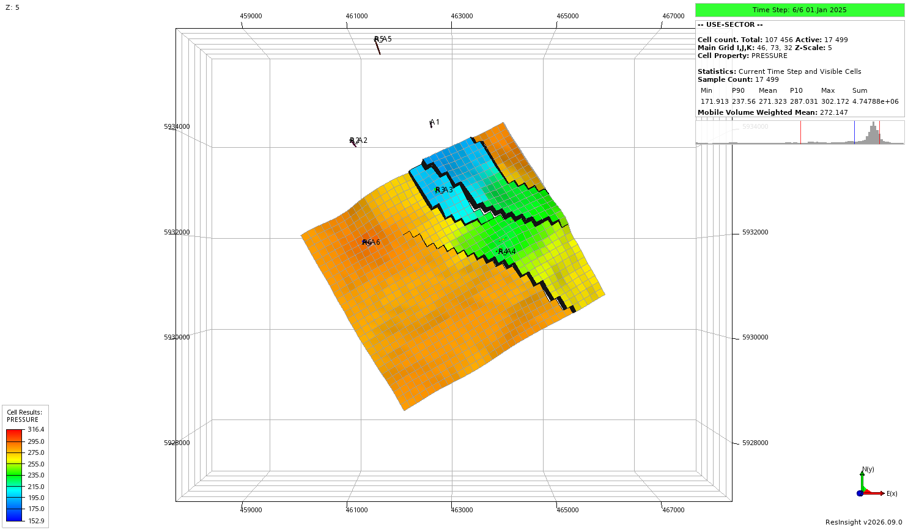
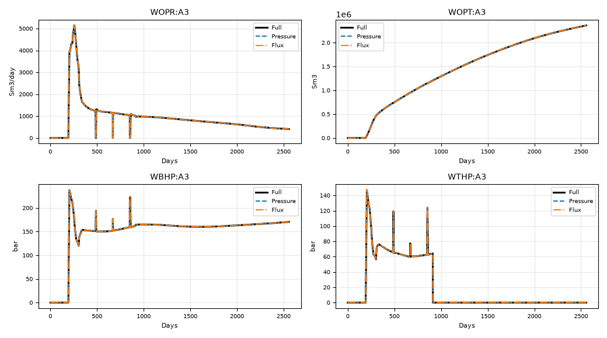
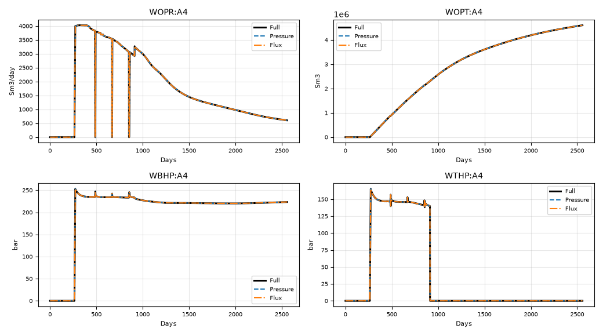
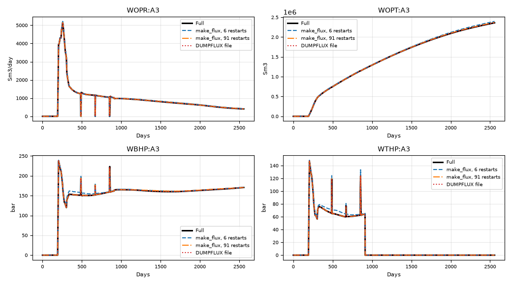
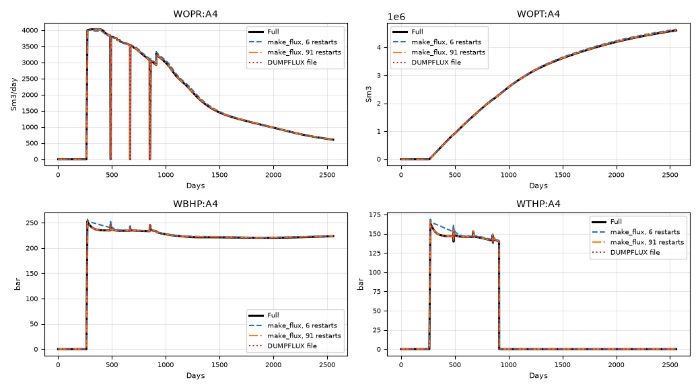
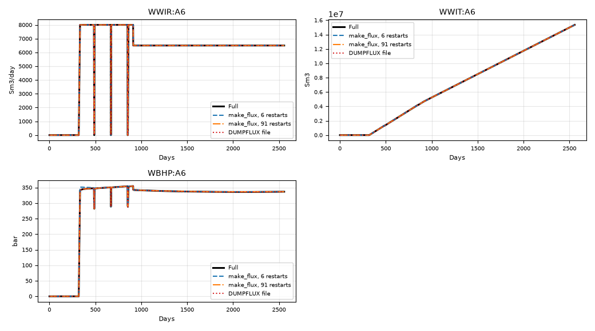

# Worked examples {#worked-examples}

The examples use Drogon, a synthetic three-phase model with dissolved gas
and vaporised oil, faults, seven equilibration regions with threshold
pressures, and a history period followed by a prediction. The grid has
46 × 73 × 32 cells, of which 72 339 are active. The sector is the box
I = 10–41, J = 37–64, K = 1–32, which holds 17 499 active cells, a quarter of
the model, and three of the six wells: producers A3 and A4 and water injector
A6. Producers A1 and A2 and injector A5 lie outside it.

{width=80%}

All runs were made with `flow` and the decks below. The files and the
commands are listed with each example; the comparisons are between the
summary files of the parent run and of the reduced runs. The deviation given
in the tables is the largest absolute difference over the whole run,
relative to the largest absolute value of the parent's vector.

| Run | Active cells | Wall time |
|:--|--:|--:|
| Parent, `DUMP-SECTOR` | 72 339 | 105 s |
| Reduced on the parent deck, `USE-SECTOR` | 17 499 | 27 s |
| Reduced on the cut-out sector deck, `SECTOR-UF-R2` | 17 499 | 26 s |

The wall times are for runs with four threads each, made one after the
other on the same machine.

## Example 1: DUMPFLUX and USEFLUX on the parent deck {#example-1-dumpflux-and-useflux-on-the-parent-deck}

This is the simplest way to run a sector: the parent run writes the boundary
data with DUMPFLUX, and the reduced run is the same deck with USEFLUX
instead, so that everything outside the sector is made inactive.

### The parent run

The parent deck `DUMP-SECTOR.DATA` defines the sector with FLUXNUM, asks for
the boundary data with DUMPFLUX and selects pressure boundaries with
FLUXTYPE. These lines are added to the GRID section:

```
DUMPFLUX

FLUXTYPE
  'PRESSURE' /

EQUALS
  FLUXNUM 0 /
  FLUXNUM 1 10 41 37 64 1 32 /
/
```

and FLUXALL to the SUMMARY section, so that the vectors the reduced run
needs about the rest of the field are reported:

```
SUMMARY

ALL
PERFORMA
FLUXALL
```

Running the deck,

```
flow DUMP-SECTOR.DATA
```

writes `DUMP-SECTOR.FLUX` next to the usual output. The print file says
what it does:

```
DUMPFLUX bootstrap: initialized 1 region dumper(s) from FLUXNUM
DUMPFLUX will write sector boundary data every time step, at most every 1 day(s)
DUMPFLUX will embed 176 summary vector(s), sampled at most every 1 day(s)
```

The FLUX file is 34 MB. It holds 2427 boundary faces, a boundary record at
each of the 157 time steps, and 176 summary vectors of the parent.

### The reduced run

The reduced deck `USE-SECTOR.DATA` is the same deck with the GRID section
changed to

```
USEFLUX
  'DUMP-SECTOR' /

FLUXTYPE
  'PRESSURE' /

FLUXREG
  1 /

EQUALS
  FLUXNUM 0 /
  FLUXNUM 1 10 41 37 64 1 32 /
/
```

USEFLUX names the FLUX file to read, `DUMP-SECTOR.FLUX`, and FLUXREG selects
region 1. FLUXTYPE has no effect in a reduced run, since the file says which
kind of boundary it holds, and is only kept so that the decks differ in as
little as possible. FLUXALL can be left out. Nothing needs to change in the
SCHEDULE section: the wells outside the sector are still there, and simply
have no connections in the reduced grid.

```
flow USE-SECTOR.DATA
```

The print file reports what was read:

```
USEFLUX: 157 boundary record(s) read from 'DUMP-SECTOR.FLUX' (per time step),
         interpolated in time between records
USEFLUX: summary vectors loaded from flux file 'DUMP-SECTOR.FLUX' (176 keys, 156 samples)
USEFLUX: adopted the producing run's threshold pressures over 7 equilibration region(s)
```

{width=80%}

{width=80%}

### Flux boundaries

For a flux boundary, FLUXTYPE in the parent is changed to `'FLUX'`
(`DUMP-SECTOR-FLUX.DATA`), and the reduced deck reads the resulting file
(`USE-SECTOR-FLUX.DATA`):

```
-- parent, DUMP-SECTOR-FLUX.DATA       -- reduced, USE-SECTOR-FLUX.DATA
DUMPFLUX                               USEFLUX
                                         'DUMP-SECTOR-FLUX' /
FLUXTYPE                               FLUXREG
  'FLUX' /                               1 /
```

A flux-mode file only holds the component mass rates across each face, and
is smaller: 9.7 MB against 34 MB.

### Results

Both reduced runs follow the parent closely. The table lists the field
vectors and those well vectors of the in-sector wells that are non-zero in
the parent.

| Vector | Parent (end) | Pressure mode | Flux mode |
|:--|--:|--:|--:|
| `FOPR` | 1883.5 | 0.31 % | 0.31 % |
| `FOPT` | 1.3408e+07 | 0.02 % | 0.00 % |
| `FPR` | 252.73 | 4.18 % | 4.14 % |
| `FPRFLUX` (parent: `FPR`) | 252.73 | 0.03 % | 0.02 % |
| `WOPR:A3` | 406.59 | 0.17 % | 0.07 % |
| `WOPT:A3` | 2.3609e+06 | 0.04 % | 0.02 % |
| `WBHP:A3` | 170.53 | 0.17 % | 0.06 % |
| `WTHP:A3` | 0 | 0.15 % | 0.07 % |
| `WOPR:A4` | 605.79 | 0.18 % | 0.08 % |
| `WOPT:A4` | 4.6084e+06 | 0.04 % | 0.00 % |
| `WBHP:A4` | 223.38 | 0.02 % | 0.05 % |
| `WTHP:A4` | 0 | 0.12 % | 0.10 % |
| `WWIR:A6` | 6500 | 0.00 % | 0.00 % |
| `WWIT:A6` | 1.5356e+07 | 0.00 % | 0.00 % |
| `WBHP:A6` | 336.44 | 0.08 % | 0.09 % |

{width=100%}

FOPR and FOPT of the reduced runs are field totals: they include the
production of A1 and A2, which lie outside the sector, at their rates in the
parent. The largest deviation in FOPR, 0.3 %, is confined to a few time
steps around day 865, where the producers are briefly shut in; over the
rest of the run the reduced runs agree with the parent to within a few
thousandths of a percent.

{width=100%}

FPR of a reduced run is the hydrocarbon pore volume weighted pressure of the
cells it simulates, the sector alone, and differs from the parent's FPR by
some 12 bar at the end of the run. FPRFLUX is the same average taken over the
whole parent model: the parent recorded pore volume weighted sums over every
cell outside the sector in the FLUX file, and the reduced run adds its own
cells to them. FPRFLUX is therefore the quantity to compare with the
parent's FPR, and it agrees to 0.03 %. The same whole-model averages are
used to convert reservoir voidage rates to surface rates for wells on
RESV control, as in the parent.

{width=100%}

{width=100%}

{width=100%}

## Example 2: make_flux and a cut-out sector deck {#example-2-make_flux-and-a-cut-out-sector-deck}

The second example shows the other extreme: the boundary data is built after
the fact with make_flux, and the reduced run uses a deck of its own, with a
grid that holds only the sector.

### Building the FLUX file with make_flux

make_flux reads the parent's deck and output. Any run will do; here the
output of `DUMP-SECTOR` is used, ignoring the FLUX file that run wrote. The
sector is given as the same box as above:

```
make_flux --parent=DUMP-SECTOR --mapping-inline='box 10 37 1 41 64 32' \
          --output=TEST.FLUX
```

The box is written as `box i1 j1 k1 i2 j2 k2`, one-based and inclusive. The
mode defaults to pressure. make_flux reports what it found:

```
Embedding 176 of the parent's 872 summary vectors, drawn from 16 keyword(s) a reduced run can use
Note: the parent wrote 6 restart step(s) over 121 report step(s), so the boundary is
      described at that cadence. The summary is embedded at its own.
      Rerun the parent with RPTRST BASIC=2 for a record at every report step.
Wrote pressure-mode FLUX file 'TEST.FLUX' for region 1 with 2427 boundary faces,
      6 report steps and 156 summary samples
```

The summary vectors that are embedded are those the parent reported. A
vector the parent did not report cannot be embedded, which is why the parent
has FLUXALL: it makes sure the parent reports everything a reduced run needs
about the wells outside the sector and about what its UDQs and ACTIONX
conditions refer to.

### The cut-out sector deck

`sector/job/SECTOR-UF.DATA` is a deck for the sector alone. Its grid is the
32 × 28 × 32 box cut out of the parent grid, with the parent's properties,
faults and transmissibility multipliers restricted to it. The deck runs on
its own; to make it a reduced run, these lines are added to its GRID
section:

```
USEFLUX
  '../../TEST' /

FLUXTYPE
  'PRESSURE' /

FLUXREG
  1 /

EQUALS
  FLUXNUM 1 /
/
```

The FLUX file is named relative to the deck, without the `.FLUX` extension.
FLUXNUM covers the whole of the sector grid, since every cell in it belongs
to the sector. The reduced run recognises that its grid is the box the FLUX
file describes, and maps the parent's cell indices into it.

The schedule of the sector deck only has the wells inside the sector, A3, A4
and A6, and their RFT companions. The FLUX file lists the parent's other
wells, and they are added without connections:

```
USEFLUX: 5 well(s) of the parent run are not in this deck and have been added without
         connections, their rates taken from '../../TEST.FLUX': R_A2 R_A5 A1 A2 A5
USEFLUX: 7 boundary record(s) read from '../../TEST.FLUX' (per report step),
         interpolated in time between records
```

{width=80%}

### Restart output and accuracy

A restart file is a snapshot, so a FLUX file built by make_flux only
describes the boundary where the parent wrote one. The Drogon base case
writes six restarts over seven years. The reduced run interpolates between
them, which is enough for the field totals but leaves visible errors in the
pressures of the wells near the boundary. To get a better boundary, the
parent is rerun with a restart at every report step. In
`DUMP-SECTOR-R2.DATA` the history schedule asks for

```
RPTRST
 BASIC=2 FLOWS FLORES /
```

and the prediction schedule no longer switches restart output off between
its report steps. That gives 91 boundary records in `TEST-R2.FLUX`, built
with the same make_flux command. `SECTOR-UF-R2.DATA` is `SECTOR-UF.DATA`
reading that file. For comparison, the cut-out sector was also run on the
DUMPFLUX file of example 1, which has a record at every time step. That
works because the FLUXNUM region of `DUMP-SECTOR` is exactly the cut-out
box.

| Vector | Parent (end) | make_flux, 6 restarts | make_flux, 91 restarts | DUMPFLUX file |
|:--|--:|--:|--:|--:|
| `FOPR` | 1883.5 | 1.01 % | 0.31 % | 0.31 % |
| `FOPT` | 1.3408e+07 | 0.56 % | 0.14 % | 0.02 % |
| `FPR` | 252.73 | 4.13 % | 4.17 % | 4.18 % |
| `FPRFLUX` (parent: `FPR`) | 252.73 | 2.62 % | 0.21 % | 0.03 % |
| `WOPR:A3` | 406.59 | 2.89 % | 0.26 % | 0.17 % |
| `WOPT:A3` | 2.3609e+06 | 1.50 % | 0.46 % | 0.05 % |
| `WBHP:A3` | 170.53 | 7.08 % | 0.71 % | 0.17 % |
| `WTHP:A3` | 0 | 9.55 % | 0.10 % | 0.15 % |
| `WOPR:A4` | 605.79 | 1.98 % | 0.23 % | 0.18 % |
| `WOPT:A4` | 4.6084e+06 | 0.87 % | 0.17 % | 0.04 % |
| `WBHP:A4` | 223.38 | 4.58 % | 0.43 % | 0.02 % |
| `WTHP:A4` | 0 | 7.18 % | 0.14 % | 0.12 % |
| `WWIR:A6` | 6500 | 0.00 % | 0.00 % | 0.00 % |
| `WWIT:A6` | 1.5356e+07 | 0.00 % | 0.00 % | 0.00 % |
| `WBHP:A6` | 336.44 | 2.81 % | 0.20 % | 0.08 % |

{width=100%}

{width=100%}

{width=100%}

{width=100%}

{width=100%}

With a restart at every report step, the cut-out sector built by make_flux
is within 0.5 % of the parent in every rate and cumulative, and within 1 % in
every pressure. The cut-out grid itself costs nothing in accuracy: on the
DUMPFLUX file it is as close to the parent as the reduced run on the parent
deck in example 1.

## Example 3: UDQs over wells outside the sector {#example-3-udqs-over-wells-outside-the-sector}

Drogon has no UDQs, so for this example two are added to the prediction
period of both the parent and the cut-out sector deck, just ahead of the
prediction schedule:

```
-- Oil rate of the producers outside and inside the sector
UDQ
  DEFINE FUOUTOPR  WOPR 'A1' + WOPR 'A2' /
  UNITS  FUOUTOPR  SM3/DAY /
  DEFINE FUSECOPR  WOPR 'A3' + WOPR 'A4' /
  UNITS  FUSECOPR  SM3/DAY /
/
```

and both are reported in the SUMMARY section. FUOUTOPR only depends on wells
that the sector does not simulate, and that its deck does not even define.
The parent is `DUMP-SECTOR-UDQ.DATA`, which is `DUMP-SECTOR-R2.DATA` with the
UDQs; FLUXALL is already in its SUMMARY section and makes it report WOPR of
every well the UDQs refer to. The FLUX file is built as before,

```
make_flux --parent=DUMP-SECTOR-UDQ --mapping-inline='box 10 37 1 41 64 32' \
          --output=TEST-UDQ.FLUX
```

and the sector deck `SECTOR-UF-UDQ.DATA` reads it. Since A1 and A2 are added
to the sector's schedule from the FLUX file, after the deck has been read,
the check that would otherwise reject a UDQ over a well the deck does not
define is turned into a warning, and the UDQ is evaluated once the wells are
in place.

| Vector | Parent (end) | Cut-out sector |
|:--|--:|--:|
| `FOPR` | 1883.5 | 0.31 % |
| `FOPT` | 1.3408e+07 | 0.14 % |
| `FPR` | 252.73 | 4.17 % |
| `FPRFLUX` (parent: `FPR`) | 252.73 | 0.21 % |
| `FUOUTOPR` | 871.1 | 0.00 % |
| `FUSECOPR` | 1012.4 | 0.47 % |

{width=100%}

FUOUTOPR is reproduced exactly, since the rates of A1 and A2 are the
parent's. FUSECOPR is the sum of the two producers the sector simulates, and
deviates by as much as they do. A UDQ used as a group target, or an ACTIONX
condition, works the same way: the reduced run sees the parent's values for
whatever it cannot compute itself.

## Reproducing the examples

The decks are in the Drogon test model, `test/drogon0`. The script
`tools/run-examples.sh` in this folder makes all the runs above in a scratch
directory, and the figures are made with the scripts next to it:

```
tools/run-examples.sh <drogon0 directory> <scratch directory>
tools/compare.py --help
tools/snapshots.py <scratch directory> images   # needs ResInsight
```
